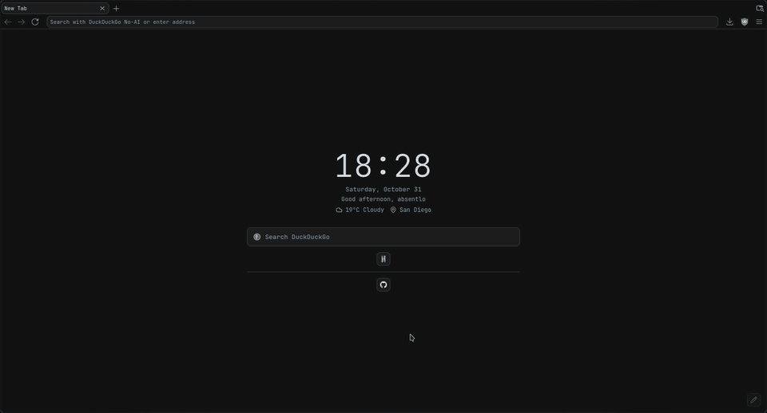
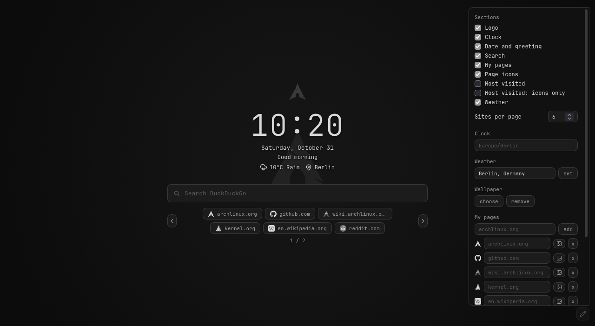

# Graphite LibreWolf

A minimal gray theme and new tab page for LibreWolf, made for low-spec PCs. No animations, no background code, and nothing uses the network unless you turn it on.



## Install

You need LibreWolf opened at least once, and [JetBrainsMono Nerd Font](https://www.nerdfonts.com/) (on Arch: `sudo pacman -S ttf-jetbrains-mono-nerd`).

**1. Install the theme**

```sh
git clone https://github.com/absentlo/librewolf-css.git
cd librewolf-css
./install.sh
```

Then restart LibreWolf. Your current `user.js` and `chrome` folder are backed up first. If you have several profiles, it asks which one to use, and `about:profiles` shows the one in use.

**2. Install the start page**

1. Download `graphite-start.xpi` from the newest version on [Releases](https://github.com/absentlo/librewolf-css/releases).
2. Open `about:addons`, click the gear, and choose **Install Add-on From File**.
3. Pick the file and click **Add**.

**3. Customize it**

Open a new tab and click the pencil in the bottom-right corner.

To use the start page in private windows, open **Graphite Start** in `about:addons` and set **Run in Private Windows** to **Allow**.

> **Firefox:** the add-on needs version 140 or newer, but only LibreWolf 159 has been tested.

## What you can customize



- **Sections:** show or hide the logo, clock, date, search, pages and weather.
- **Clock:** 12 or 24 hour, three sizes, your time zone and your name.
- **Search:** six search engines.
- **Weather:** your city, in °C or °F.
- **Wallpaper:** your own image, with a darkness slider. It's resized to 1920 px wide to keep new tabs fast, and animated images become still.
- **Pages:** your own sites and your most visited ones, with gray logos and custom names.
- **Backup:** save all of this to a file and load it again later.

## Privacy

These are off until you turn them on. LibreWolf asks your permission first.

| Option | What it contacts | What that sees |
|---|---|---|
| Weather | [Open-Meteo](https://open-meteo.com/) | Your IP address and city, at most every 30 minutes |
| Page icons | DuckDuckGo's icon service | Your IP address and the site's name, once per site |
| Most visited | Nothing | Your history is read locally |

Searches go to the engine you pick. Nothing else on the page uses the network.

## Update

- **Theme:** run `git pull` and `./install.sh`, then restart LibreWolf.
- **Start page:** install the new file from [Releases](https://github.com/absentlo/librewolf-css/releases) the same way. Keep a normal website tab open first: updating closes the start page's tabs, and if they're the only ones open, the window closes too.

## Move to a new profile

The theme lives inside the profile folder, so a new profile starts without it.

1. In the old profile, open the panel and click **export**. The file holds your wallpaper and page addresses in plain text, so keep it private.
2. Open the new profile once, close it, and run `./install.sh`.
3. Install the start page again, then click **import**.
4. Tick **Weather**, **Page icons** and **Most visited** again, since permissions don't carry over.

Don't copy a whole profile folder: the browser can end up pointing at the copy instead of your real profile.

## Change the theme

- **Colors:** the variables at the top of `profile/chrome/userChrome.css` and `startpage/newtab.css`.
- **Font:** `--g-font` in `userChrome.css`.
- **Window buttons:** on a tiling window manager such as i3 or sway, uncomment the marked block in `userChrome.css` to hide them.
- **Settings:** `profile/user.js` has a comment on every line, including AV1 video and the bookmarks bar being off. If you delete a line, also reset that setting in `about:config`.
- **Start page code:** raise `version` in `startpage/manifest.json` and run `./install.sh --build-addon` (needs `zip`). Your build is unsigned, so installing it needs `xpinstall.signatures.required` set to `false` in `about:config`, which lets LibreWolf install any unsigned add-on.

Run `./install.sh` again after editing, because the browser uses the copies in your profile.

## Problems

- **No theme:** check that `toolkit.legacyUserProfileCustomizations.stylesheets` is `true` and that you installed into the profile in use.
- **Something broke after a browser update:** updates can rename what the theme targets. Set `devtools.chrome.enabled` to `true`, then press `Ctrl+Alt+Shift+I` to inspect the browser.
- **Wrong time:** type your zone in **Time zone**, such as `Europe/Berlin`.
- **A setting keeps coming back:** `user.js` reapplies at every start, so change it there.

## Uninstall

1. Remove the add-on from `about:addons`. This also deletes its settings, so click **export** first if you want to keep them.
2. Delete `user.js` and `chrome` from the profile folder, or restore your `.bak-` copies.
3. Reset any settings you want back in `about:config`.

## License

MIT, see [LICENSE](LICENSE). The logos and some icons belong to others, see [THIRD-PARTY-NOTICES](THIRD-PARTY-NOTICES).
