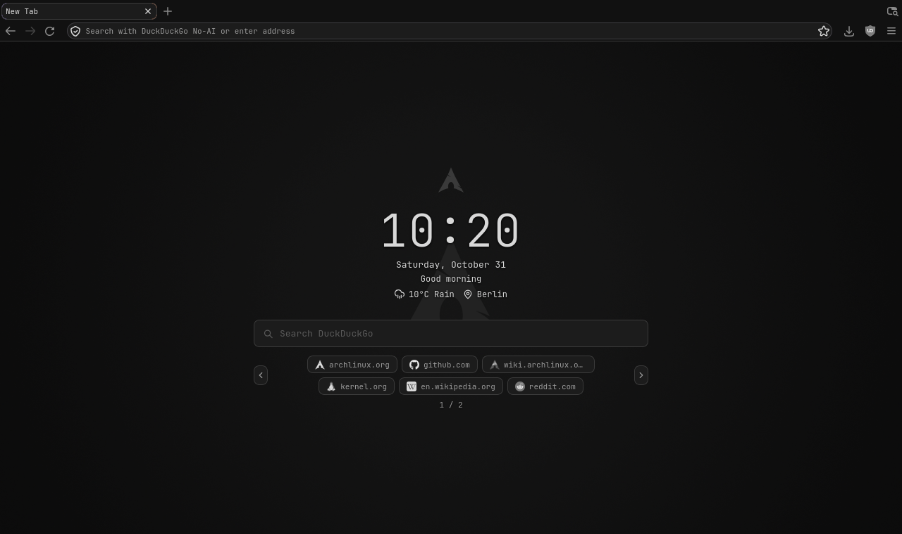

# Graphite LibreWolf

A minimal gray theme for LibreWolf, with a customizable new tab page. It is built for low-spec PCs: no animations, no background code, and no network use unless you turn it on.




## What you get

**Theme (`profile/`)**
- Flat grays everywhere: tabs, toolbar, menus, address bar, settings and add-on pages.
- A compact layout with thinner tabs and toolbars.
- Gray icons on background tabs and bookmarks.
- Performance preferences for machines with around 8 GB of RAM.

**Start page (`startpage/`)**, all set from the pencil button in the corner:
- Clock, date and greeting, and search. Hide any of them, including the logo.
- Your own wallpaper.
- Weather for your city, with icons for the conditions and for day or night.
- Your pages and your most visited sites, with logos recolored to the gray palette.
- A custom name or logo-only display for each of your pages.
- A limit on sites per page. Past that limit, browse with the arrows, the mouse wheel or the left and right keys.

## Why a new profile loses everything

LibreWolf and Firefox keep your theme and settings **inside the profile folder**, not in the browser. A new profile starts as an empty folder, so `user.js` and the `chrome` folder are simply not there, and the browser looks like it did on day one.

The fix is to copy those files into the new profile. That is all `install.sh` does, and you can do it by hand too.

| File | Where it goes | What it does |
|---|---|---|
| `profile/user.js` | `<profile>/user.js` | Preferences, applied at every start |
| `profile/chrome/userChrome.css` | `<profile>/chrome/userChrome.css` | Styles the browser itself |
| `profile/chrome/userContent.css` | `<profile>/chrome/userContent.css` | Styles settings and internal pages |
| `startpage/` | Installed as an add-on | The new tab page |

## Install

### 1. Install the font

The theme uses JetBrainsMono Nerd Font. On Arch:

```sh
sudo pacman -S ttf-jetbrains-mono-nerd
```

To use another font, change `--g-font` at the top of `userChrome.css`.

### 2. Install the theme

Open the browser at least once so the profile exists, then run:

```sh
git clone <this repository's URL>
cd graphite-librewolf
./install.sh
```

If you have several profiles, it asks which one to use. Open `about:profiles` in the browser to see which is in use, or name it directly:

```sh
./install.sh --profile ~/.config/librewolf/librewolf/xxxxxxxx.default-release
```

The script backs up an existing `user.js` and `chrome` folder as `<name>.bak-<timestamp>`, then builds the add-on into `dist/`. It needs `zip`. Use `--no-addon` if you only want the theme.

Restart the browser to see the theme.

<details>
<summary>Install the theme by hand</summary>

1. Open `about:profiles` and click **Open Directory** next to the profile in use.
2. Copy `profile/user.js` into that folder.
3. Create a folder named `chrome` there, and copy both `.css` files into it.
4. Restart the browser.

</details>

### 3. Install the start page

The add-on isn't signed by Mozilla, so the browser has to be told to accept it.

**LibreWolf**

1. Open `about:config` and set `xpinstall.signatures.required` to `false`.
2. Open `about:addons`, click the gear, and choose **Install Add-on From File**.
3. Pick `dist/graphite-start.xpi`, then click **Add**.

This setting lets the browser install any unsigned add-on, so only install add-on files you trust.

**Firefox**

Regular Firefox ignores that setting and refuses unsigned add-ons. You have two options:

- Open `about:debugging`, choose **This Firefox**, then **Load Temporary Add-on**, and pick `startpage/manifest.json`. It disappears when the browser restarts.
- Use Firefox Developer Edition, Nightly or ESR, which do honor the setting above.

Only LibreWolf 159 on Arch Linux has been tested. Firefox shares the same base, but its interface can differ.

### 4. Set up the start page

Open a new tab and click the pencil in the bottom-right corner.

Start page settings (wallpaper, pages, city) live inside the add-on's storage in the profile, so `install.sh` can't copy them. Set them again in each new profile.

## Moving to a new profile

1. Create the profile and open it once.
2. Run `./install.sh` and choose the new profile.
3. Install the add-on again (step 3 above) and set up the start page.

Copy only the files listed here, not a whole profile folder. A copied profile carries its identity with it, and the browser can end up pointing at the copy instead of your real profile.

## Customize

- **Colors:** edit the variables at the top of `userChrome.css`, then restart. The start page has its own copy at the top of `startpage/newtab.css`.
- **Window buttons:** they stay visible by default. On a tiling window manager such as i3 or sway, uncomment the `.titlebar-buttonbox-container` block in `userChrome.css` to hide them.
- **Preferences:** every line in `user.js` has a comment. Delete what you don't want, then **also reset it in `about:config`**, because deleted lines don't undo a value that was already applied.
- **Search engine:** change the form's `action` in `startpage/newtab.html`.
- **Time zone:** the clock normally follows the browser. If it shows the wrong time, which can happen with fingerprinting protection, type your zone in the **Clock** field of the panel, such as `Europe/Berlin`.

After changing anything in `startpage/`, raise `version` in `manifest.json`, run `./install.sh`, and install the new `.xpi`.

**Before you update the add-on,** keep a normal website tab open. Updating closes the start page's own tabs, and if those are the only tabs open, the window closes too.

## Privacy

Everything is off until you turn it on, and the browser asks before the two options that need a permission.

| Option | Contacts | What it can see |
|---|---|---|
| Weather | [Open-Meteo](https://open-meteo.com/) | Your IP address and your city, when you set a city and at most every 30 minutes after that |
| Page icons | DuckDuckGo's icon service | Your IP address and the site's name, once per site. Icons are then stored locally |
| Most visited | Nothing | Reads your browsing history locally, and needs your permission |

Search goes to DuckDuckGo. The rest of the page makes no network requests.

## Troubleshooting

- **The theme doesn't appear:** check that `toolkit.legacyUserProfileCustomizations.stylesheets` is `true` in `about:config`, that the `chrome` folder is inside the profile in use, and that you restarted.
- **"This add-on could not be installed because it has not been verified":** see step 3.
- **Something looks wrong after a browser update:** browser updates sometimes rename the internal parts this theme targets. Open `about:config`, set `devtools.chrome.enabled` to `true`, then press `Ctrl+Alt+Shift+I` to inspect the browser.
- **Most visited is empty:** the browser needs some browsing history before it has sites to show.
- **A setting keeps coming back after you change it:** `user.js` reapplies its values at every start, so change it there.

## Uninstall

1. Remove the add-on from `about:addons`. This deletes its saved wallpaper and settings.
2. In the profile folder, delete `user.js` and `chrome`, or restore your `.bak-` copies.
3. Reset any preferences you want back in `about:config`, since deleting `user.js` doesn't undo values already applied.

## Credits and license

MIT, see [LICENSE](LICENSE). Some icons are adapted from [Lucide](https://lucide.dev/), and the Arch Linux logo belongs to Arch Linux; both are covered in that file. To remove the logo, untick **Logo** in the panel or delete it from `startpage/newtab.html`.
